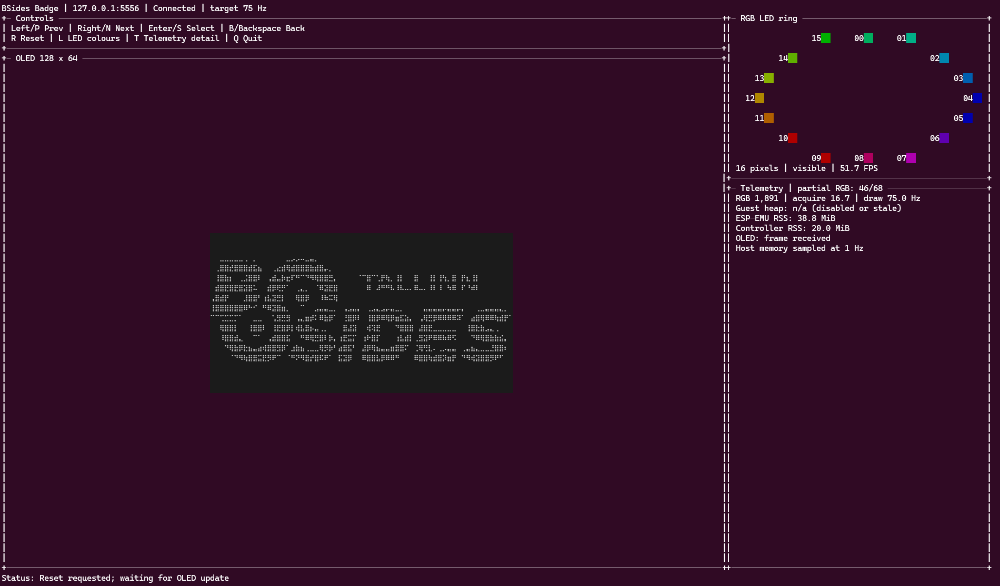

# BSides Tallinn Badge Emulator

This directory contains the development and testing environment for running the BSides Tallinn badge firmware using [Espressif ESP-EMU](https://github.com/espressif/esp-emulator).

The emulator executes the standard ESP32-C3 MicroPython firmware together with the application files from `software/`. It does not require an alternative application implementation or mocked MicroPython hardware drivers.



## Features

- Docker-based merged firmware generation.
- ESP32-C3 instruction and peripheral emulation.
- SSD1306 OLED display emulation.
- Four virtual navigation buttons.
- Circular visualisation of 16 WS2812 RGB LEDs.
- Interactive terminal user interface (TUI).
- Configurable display refresh rate.
- Configurable LED colour rendering, rotation and direction.
- Reusable TCP control library.
- RGB frame rate and control interface benchmarking.
- Unit tests for emulator tooling.

## Prerequisites

The environment has been tested on Linux under Windows Subsystem for Linux 2 (WSL2).

| Dependency | Version or requirement |
| --- | --- |
| Docker Engine | Operational installation |
| Python | 3.10 or newer |
| ESP-EMU | 1.2.0 |
| MicroPython | 1.29.0, ESP32_GENERIC_C3 |
| Terminal | Unicode and curses support |
| Terminal colours | 256 colours recommended |

The firmware builder installs its Python dependencies inside a Docker container. ESP-IDF, a native ESP32 compiler toolchain and a physical badge are not required.

Verify the local environment:

```sh
docker version
docker run --rm hello-world
python3 --version
```

The interactive controller uses the Python standard library and does not require additional Python packages.

## External dependencies

From a clean clone, run the following commands in the repository root. Docker and Python 3.10+ must already be installed.

```sh
python scripts/badge.py emulator restore
python scripts/badge.py emulator build
python scripts/badge.py emulator run
```

Run `python scripts/badge.py emulator controller` in a separate terminal. Linux/WSL2 x86-64 and ARM64 are supported by the
bootstrap; ARM64 has not yet been tested.

`python scripts/badge.py emulator restore` downloads versioned dependencies listed in
`dependencies.json`. ESP-EMU and its example archive are verified against
pinned release SHA-256 digests. The executable is installed locally in
`emulator/bin/` and the three WASM modules in `emulator/`.
Verified archives are reused from `emulator/.cache/`.

MicroPython is downloaded from its fixed HTTPS release URL and verified
against the SHA-256 recorded from a successful dependency download.
This is a locally observed pin, not an independently published upstream
checksum. All downloads require a valid pinned digest.

Restore also prepares the pinned Docker builder. Build uses restored dependencies and the existing builder image, with no container network access. Run verifies existing artifacts and starts the emulator without invoking Docker. No global ESP-EMU installation is necessary.

`python scripts/badge.py emulator clean` preserves downloaded dependencies; `python scripts/badge.py emulator clean --all` removes
them. The Docker base image is digest-pinned and all Python package versions and distribution hashes are pinned in `requirements.lock`. The builder enforces those hashes and runs `pip check`. For dependency updates, edit `requirements.pins`, run `python emulator/generate_lock.py` on a network-connected host and redirect the output to a temporary file before replacing the lock, review the generated lock and validate a fresh build. The separate requirements-build.lock pins the setuptools wheel used to build esptool 4.9.0. Build isolation is disabled and other runtime packages must install from wheels. A fresh Docker build validates availability for the target architecture.

## Virtual hardware

The default `board.json` describes the 2025 badge. Select another revision with `python scripts/badge.py emulator build --badge-version 2026` or `--badge-version 2025_prototype`. The staged badge configuration and board wiring are selected together. Battery ADC and plug-in PWM remain unsupported.

| Peripheral | GPIO | Configuration |
| --- | --- | --- |
| SSD1306 SDA | 0 | Hardware I²C controller 0 |
| SSD1306 SCL | 1 | Hardware I²C controller 0 |
| WS2812 data | 3 | 16 RGB LEDs |
| SELECT | 4 | Active-low |
| NEXT | 5 | Active-low |
| PREV | 8 | Active-low |
| BACK | 9 | Active-low |

The SSD1306 display has a resolution of 128 × 64 pixels and uses I²C address `0x3C`.

The firmware configuration and virtual board must describe the same hardware revision. For the 2026 badge, SELECT uses GPIO10 instead of GPIO4. The 2025 prototype uses OLED address `0x3D`.

Battery measurement and plug-in LED emulation are not currently implemented.

## Firmware generation

All commands in this document are executed from the repository root unless stated otherwise.

### Restore the Docker image and dependencies

```sh
python scripts/badge.py emulator restore
```

This creates the `bsides-firmware-builder:1.0` Docker image containing the firmware packaging tools.

The image needs to be rebuilt when the Dockerfile or its dependencies change.

### Generate the merged firmware

```sh
python scripts/badge.py emulator build
```

The build script stages Python, JSON and PEM application files, excluding local identity and legacy configuration, then generates a LittleFS image. The selected revision is written to a fresh badge configuration. Input fingerprints permit reuse of verified firmware; use `python scripts/badge.py emulator build --force` to force generation or `python scripts/badge.py emulator run` to launch existing verified firmware without rebuilding.

The container runs with the UID and GID of the current user to avoid creating root-owned artifacts on the host filesystem.

### Flash layout

The build script targets the following ESP32-C3 flash layout:

| Component | Offset | Size |
| --- | --- | --- |
| Bootloader and partition metadata | `0x000000` | Reserved region |
| NVS | `0x009000` | 24 KiB |
| PHY initialization | `0x00F000` | 4 KiB |
| MicroPython application | `0x010000` | 1,984 KiB |
| LittleFS filesystem | `0x200000` | 2,048 KiB |
| End of flash | `0x400000` | — |

The LittleFS region occupies the remaining flash space after the factory application partition. MicroPython registers its default filesystem partition at runtime.

The resulting merged image is 4,194,304 bytes (4 MiB).

### Build artifacts

| File | Description |
| --- | --- |
| `firmware-build/micropython.bin` | Original MicroPython firmware |
| `firmware-build/vfs.bin` | Application filesystem image |
| `firmware-build/bsides-badge-esp32c3.bin` | Merged flash image |
| `firmware-build/SHA256SUMS` | Artifact checksums |
| `firmware-build/build-requirements.txt` | Build environment package versions |
| `firmware-build/builder.identity` | Restored builder identity and input digest |
| `firmware-build/badge-version`, `input.sha256`, `build-profile.sha256` | Build profile, fingerprint and metadata checksum |

Generated artifacts are verified automatically by build and run.

Rebuild and verify the firmware after modifying the application:

```sh
python scripts/badge.py emulator build
```

Stop the running emulator before replacing its firmware image. Restore, build, run and clean coordinate using Python fcntl.flock on emulator/.build.lock, which is never removed by cleanup. Launch holds an exclusive lock for its lifetime. Lock waits are bounded by `--lock-timeout` (default 120 seconds). Standalone maintenance scripts and direct Docker invocations must not run concurrently with these operations.

## Running the emulator

Start the emulator in the first terminal:

```sh
python scripts/badge.py emulator run
```

Run reads the hardware revision and guest instrumentation profile from the existing build metadata and verifies its checksum binding to the artifact manifest. Existing Makefile-era artifacts must be rebuilt once using the new CLI. It never restores or builds. The emulator loads the merged firmware, attaches the virtual peripherals and exposes its TCP control interface on `127.0.0.1:5556`.

The terminal displays firmware serial output and emulator diagnostics.

Co-simulation logging is disabled by default. To write diagnostic events to `emulator/cosim.jsonl`, start with `python scripts/badge.py emulator run --cosim-log`.

Start the interactive controller in a second terminal:

```sh
python scripts/badge.py emulator controller
```

The controller displays a single-screen dashboard with persistent help, white-on-black OLED framebuffer, animated RGB LED ring, telemetry and status. Minimum terminal size is 124 columns by 31 rows. Press L to toggle LED colour rendering and T to toggle telemetry detail. Host RSS and peak RSS are sampled once per second using Linux procfs. The controller identifies a unique local esp-emu process by its control endpoint; use `--emulator-pid 1234` to specify a local PID explicitly. Optional guest heap telemetry prints structured samples to the existing firmware console. The host forwards console output and atomically publishes the latest sample in `firmware-build/guest-heap.json`. Run `python scripts/badge.py emulator build --guest-heap` followed by `python scripts/badge.py emulator run` and `python scripts/badge.py emulator controller --guest-heap`. Only staged firmware is instrumented; no GPIO or UART is allocated. Samples are taken every guest second without forced GC; stale samples are unavailable. Minima and peaks reflect samples observed by the reader. Use `python scripts/badge.py emulator benchmark --guest-heap --memory` with the controller closed. Compare against a build without `--guest-heap` with the same workload. Host RSS is not guest RAM. Console capture is local only and still needs runtime qualification.

Do not expose the emulator control interface to an untrusted network. It permits device resets, peripheral interaction and flash operations. The default configuration binds it to the loopback interface.

## Interactive controller

### Keyboard controls

| Key | Badge action |
| --- | --- |
| Left Arrow / P | PREV |
| Right Arrow / N | NEXT |
| Enter / S | SELECT |
| Backspace / B | BACK |
| R | Reset the emulated MCU |
| L | Toggle visible/raw LED colours |
| T | Toggle telemetry detail |
| Q / Escape | Quit the controller |

The controller translates keyboard input into virtual button press and release operations.

### OLED rendering

The 128 × 64 monochrome framebuffer is rendered using Unicode Braille characters. Each terminal character represents a 2 × 4 pixel region, allowing the full display resolution to be represented using 64 columns and 16 rows.

The ESP-EMU OLED render interface returns framebuffer data only when new content is available. The controller retains the last received framebuffer between updates.

If the controller starts without a framebuffer, press R to reset the emulated device and trigger a display update.

### RGB LED rendering

The 16 RGB LEDs are displayed as a circular array. The controller reads the decoded RGB state from the virtual WS2812 peripheral.

The default layout places LED index 0 at the top and subsequent indices clockwise. Rotation and direction options allow the layout to be aligned with the physical PCB.

The physical correspondence of logical LED indices and PCB positions must be verified separately.

### LED colours

The controller provides two colour rendering modes:

| Mode | Behaviour |
| --- | --- |
| `visible` | Enhances dim colours to improve terminal visibility |
| `raw` | Approximates the original RGB intensity |

Visible mode changes presentation only. It does not alter the firmware or emulated RGB values.

Terminal palette quantisation can cause very dim colours to appear black in raw mode. Visible mode may reduce the apparent brightness variation of effects such as Breathe.

### Controller configuration

| CLI argument | Default | Description |
| --- | --- | --- |
| `--refresh-hz` | `75` | Target controller refresh frequency |
| `--led-colors` | `visible` | LED colour rendering mode |
| `--led-offset` | `0` | LED ring rotation |
| `--led-counterclockwise` | Off | Reverse LED ordering |

Run the controller at 100 Hz:

```sh
python scripts/badge.py emulator controller --refresh-hz 100
```

Use raw LED colours:

```sh
python scripts/badge.py emulator controller --led-colors raw
```

Rotate the LED ring by 90 degrees:

```sh
python scripts/badge.py emulator controller --led-offset 4
```

Reverse the LED ordering:

```sh
python scripts/badge.py emulator controller --led-counterclockwise
```

Check available terminal colours:

```sh
tput colors
```

## RGB performance measurements

The firmware defines a nominal NeoPixel refresh rate of 50 FPS in `software/rgb_leds.py`.

The effective refresh rate depends on animation computation, NeoPixel transmission, asynchronous scheduling and emulator execution speed.

To benchmark the emulator:

1. Start the emulator and controller.
2. Select a continuously animated LED effect, such as Rainbow.
3. Quit the controller without stopping the emulator.
4. Run the benchmark.

```sh
python scripts/badge.py emulator benchmark
```

The benchmark reports:

- Effective RGB frame rate.
- Decoded frame counter.
- Detected LED count.
- Control interface polling frequency.
- TCP response latency.
- Distribution of observed LED counts.

Static LED overrides and muted game lighting can suppress redundant NeoPixel writes. They are therefore unsuitable for measuring continuous animation throughput.

The default controller target is 75 Hz for independent terminal rendering and acquisition scheduling. Actual acquisition throughput is limited by control-channel response latency. Redrawing a snapshot does not create a fresh peripheral observation.

Use `python scripts/badge.py emulator benchmark --duration 10 --interval 0.02` to adjust measurement parameters. The controller refresh frequency does not control firmware execution speed. Increasing it may improve visual sampling, but cannot guarantee that every intermediate RGB frame is observed.

## Emulator control interface

The emulator exposes a newline-delimited TCP command interface.

Connect using netcat:

```sh
nc 127.0.0.1 5556
```

Example commands:

```text
ping
help
part list
part oled state
part oled render
part rgb state
part next state
part next input press
part next input release
reset
```

The expected virtual peripherals are:

```text
oled next prev back select rgb
```

The OLED render command consumes pending framebuffer updates. Avoid running multiple independent framebuffer consumers simultaneously.

Close the interactive controller before using direct control commands or running performance measurements.

See the [ESP-EMU peripheral documentation](https://github.com/espressif/esp-emulator/blob/v1.2.0/docs/guides/PARTS.md) for additional commands.

## Source organisation

| File | Responsibility |
| --- | --- |
| `cli.py` | Host orchestration and command registration |
| `Dockerfile` | Firmware build environment |
| `fetch_dependencies.py` | Verified dependency provisioning |
| `firmware_inputs.py` | Application staging and input fingerprinting |
| `build_firmware.sh` | Filesystem generation, merging and artifact verification |
| `board.json` | Virtual hardware definition |
| `esp_control.py` | TCP transport and control protocol |
| `peripherals.py` | Virtual peripheral abstractions |
| `acquisition.py` | Control worker, immutable snapshots and input queue |
| `controller.py` | Interactive terminal rendering and keyboard handling |
| `dashboard.py` | Terminal layout |
| `heap_client.py` / `guest_heap.py` / `console_capture.py` | Optional guest heap telemetry |
| `measure_rgb_fps.py` | RGB performance diagnostics |
| `tests/unit/` | Emulator tooling unit tests |

The control transport and peripheral abstractions are independent of curses and can be reused by automated integration tests.

## Testing

Run the emulator tooling unit tests:

```sh
python scripts/badge.py test --emulator
```

Alternatively:

```sh
python3 -m unittest discover -s emulator/tests/unit -v
```

These tests do not require a running emulator. Portable unit tests also run on native Windows without curses. Real Linux file locking and process-supervision tests are skipped on Windows; symbolic-link creation is skipped if Windows denies the required privilege. Run the full suite on Linux/WSL2 before accepting emulator changes.

The unit tests cover control protocol handling, framebuffer caching, RGB state parsing, button interaction commands, terminal rendering and LED ring geometry.

The existing application tests remain in the repository's `tests/` directory. Run `python scripts/badge.py test --app`, or run both suites with `python scripts/badge.py test`.

Automated end-to-end firmware integration tests are planned separately. The current environment supports interactive firmware integration testing and automated unit testing of the emulator tooling.

## Troubleshooting

If Bash reports an invalid `pipefail` option, check for CRLF line endings
in `emulator/build_firmware.sh`. Git attributes enforce LF on fresh checkouts.
The Docker entry point also normalises CRLF before executing the build script.
For an existing affected working copy, run `sed -i 's/\r$//' emulator/build_firmware.sh`.

| Symptom | Resolution |
| --- | --- |
| `docker: permission denied` | Verify Docker daemon access and active user group membership |
| ESP-EMU executable missing | Run `python scripts/badge.py emulator restore` |
| `littlefs-python: command not found` | Build through `python scripts/badge.py emulator build` rather than invoking the packaging script directly |
| Permission denied writing build artifacts | Check ownership of `firmware-build/` |
| OLED initialization fails with `ENODEV` | Verify the SSD1306 model, I²C address and virtual wiring |
| Button not attached | Verify the corresponding peripheral in `board.json` |
| No OLED framebuffer received | Reset the emulated device and ensure there is only one render consumer |
| Dim LEDs appear black | Use visible colour mode |
| Incorrect LED orientation | Adjust LED rotation and direction |
| Fewer than 16 decoded RGB pixels | Inspect `part rgb state` and investigate incomplete frame decoding |
| Animation runs slowly | Benchmark emulator throughput separately from controller refresh |
| TAP initialization warning | User-mode networking is an acceptable fallback |
| Controller cannot connect | Verify that the emulator is running and listening on TCP port 5556 |

### File ownership

If build artifacts were previously created by a root-owned Docker container, restore ownership:

```sh
sudo chown -R "$(id -u):$(id -g)" firmware-build/
```

Subsequent builds through the Python CLI use the current user's UID and GID.

## Cleanup

Remove generated firmware and runtime artifacts:

```sh
python scripts/badge.py emulator clean
```

The original downloaded MicroPython firmware, WASM peripheral models and builder image are retained. Use `python scripts/badge.py emulator clean --all` to remove local downloaded dependencies as well; the Docker image remains managed by Docker.

Generated firmware images, downloaded peripheral models, runtime logs, screenshots and Python caches must not be committed to Git.

## Limitations

The emulator provides a functional approximation of the badge hardware. It does not establish electrical, timing or physical equivalence with the real device.

Current limitations include:

- Incomplete hardware coverage, including battery ADC and plug-in PWM LEDs.
- Differences between physical and emulated execution timing.
- Potential loss of intermediate frames through polling.
- Terminal colour palette limitations.
- Unverified physical LED index orientation.
- Limited validation of wireless communication and multiplayer hardware links.

Physical hardware testing remains necessary for power consumption, battery behaviour, electrical characteristics, communication reliability and final release validation.

## Upstream projects

- [Espressif ESP-EMU](https://github.com/espressif/esp-emulator)
- [MicroPython](https://github.com/micropython/micropython)
- [Espressif esptool](https://github.com/espressif/esptool)
- [littlefs-python](https://github.com/jrast/littlefs-python)
- [LittleFS](https://github.com/littlefs-project/littlefs)

External firmware and compiled peripheral models are obtained separately and remain subject to their respective upstream licences.

### Control latency diagnostics

Close the controller and benchmark before running `python3 emulator/probe_latency.py`. This consumes OLED updates. It compares TCP_NODELAY off/on, ping, RGB state, OLED state and sequential versus batched OLED/RGB requests. Batch results are ordered, not atomic snapshots. The controller retains the last complete 16-pixel RGB observation and counts other observations separately; the benchmark continues to report raw pixel counts. Neither behaviour proves incomplete physical transmissions. The upstream v1.2.0 public source does not include the WS2812 model or control server implementation.

### Snapshot synchronisation

The acquisition worker exclusively owns the control connection and reads the heap sample file. The curses main thread consumes immutable snapshots through a latest-value mailbox (logical triple buffering: producer state, ready reference, consumer reference). Superseded ready snapshots are counted, not queued. The input FIFO holds 32 commands; overload, stale-generation input and overlapping holds on the same button are explicitly rejected. Recovery errors do not invalidate an otherwise usable connection. Reset, reconnect and RGB counter rollback invalidate guest state. Component timestamps are host observation times, not atomic emulator timestamps. Detailed telemetry shows acquisition and render rates, batch RTT, publication age, component observation age, superseded snapshots, queue depth, generation and last input dispatch delay. The render rate is not the guest frame rate. No additional dependencies are required.

### Resource bounds

Co-simulation logging is disabled by default. Use `python scripts/badge.py emulator run --cosim-log` only for diagnostics; an enabled log has no host-side rotation or size cap. Record logging state when comparing benchmarks. The control socket has a three-second total deadline per command batch, including fragmented replies. Completed replies are not discarded merely because processing reaches the deadline. Nonblocking checks reject unsolicited bytes already available before or after a batch; the untagged protocol cannot distinguish a delayed unsolicited reply arriving during the next request from a legitimate response. The acquisition worker cooperatively cancels reads on shutdown and attempts button recovery on a still-open connection within a two-second shared deadline. A disconnected or interrupted connection cannot guarantee delivery of a release command. Benchmark latency storage is a fixed 1 ms histogram with a final overflow bucket for values at or above 10000 ms; `median_ms` is a lower-edge estimate (less than 1 ms quantisation error for non-overflow ranks), and `median_overflow` indicates that at least one median rank is in the overflow bucket. Mean and maximum use the original observations.

Unchanged producer state is not republished to the mailbox; generation changes remain observable; queue depth is sampled at publication time, not a record of every enqueue or dequeue. Guest heap snapshots are reused until a new valid record arrives or the old record expires. Failed automatic PID discovery is retried every five seconds; successful reconnection triggers immediate rediscovery. RSS sampling remains at 1 Hz.

Rendering memoises the 32 normalised LED ring orientations and the most recent terminal layout. The terminal palette is constructed once; the existing nearest-colour metric and bounded 4096-entry lookup cache are unchanged. Curses colour attributes are reused within a terminal session and invalidated at session startup. OLED decoding and full-screen redraw scheduling are unchanged.

Build and run verify restored dependencies against their pinned archives without downloading anything. A failed build invalidates its profile metadata. Interrupted container builds attempt explicit container removal before releasing the lock; if Docker is unavailable, confirm that no build container remains before retrying. The CLI does not remove the Docker builder image during cleanup.
